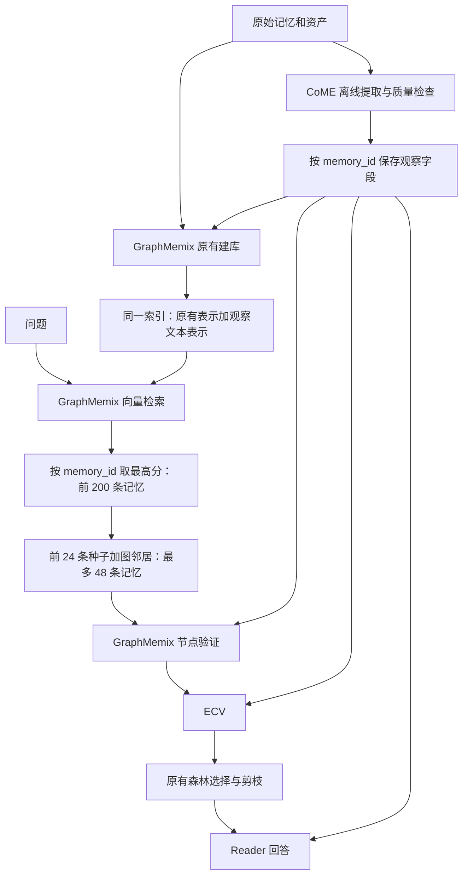

# CoME 观察字段接入 GraphMemix：下一步修改指南

日期：2026-10-19。状态：已按本方案完成代码重构和两轮小样本 GPU 链路验证。当前模块、命令、预算、回归及已发现的观察质量问题见 [CoME 接入说明](come.md)；完整 benchmark 效果对照尚未执行。下文保留目标范围与验收要求，效果提升不能由架构回归代替。

目标：CoME 负责与问题无关的细粒度观察提取和存储；GraphMemix 在原有流程中使用这些观察。检索、候选生成、验证、图推理、证据选择和回答均由 GraphMemix 负责。

**本轮范围只包含两件事：离线新增细粒度观察字段，以及让该字段贯穿 GraphMemix 的现有流程。** “新增观察”指预处理阶段的提取和存储，不是在回答问题时生成观察。原图复看、证据缺口检查、补图重试和多轮检索均不纳入本轮。

旧版 CoME 的独立检索和问答流程不再作为目标架构。本文以原版 GraphMemix 和旧版 CoME 为对照说明改动位置；讨论普通 benchmark 主流程，不改造 ATM-Hard 的独立实验流程。

## 1. 必须保持的职责边界

| 工作 | 所属模块 | 约束 |
|---|---|---|
| 从原图提取细粒度描述、事实、位置和来源 | CoME 预处理 | 不接收问题、答案、题型、检索排名或证据缺口 |
| 检查观察是否受原图／原文支持、检查坐标 | CoME 预处理 | 属于观察质量检查，不是问题相关性评分 |
| 保存观察及源文件版本 | CoME 预处理 | 同一来源快照可以服务多个问题 |
| 将观察描述编码为附加向量表示 | GraphMemix 建库 | 使用现有 embedding 和 FAISS 组件 |
| 根据问题检索、合并记忆、扩展图邻居 | GraphMemix | 保留原有记忆级流程 |
| 节点验证、ECV、森林选择、剪枝、回答 | GraphMemix | 在现有证据输入中接入观察字段 |

**首版接入保持图节点、候选 ID、选择结果和评测 ID 都是原始 `memory_id`。** `observation_id` 用于表示来源、定位细节和追踪证据，不独立占用一个记忆候选名额，也不独立获得森林节点收益。

“细粒度”首先体现在记忆内部有更具体、可回溯的描述，不意味着必须把原来的记忆图改成观察图。

CoME 在离线提取和质量检查时仍需读取原图。GraphMemix 原有的常规多模态输入按基线保留；本轮不增加由问题或证据不足触发的原图复看能力。

## 2. 目标数据流



200／24／48 来自当前 legacy 配置，用作首版对照设置，不应写死进算法。观察文本影响向量召回和后续证据判断，但不增加三路配额、不增加独立 RRF、不替换记忆级图选择。

## 3. 观察字段及存储接口

推荐在运行时使用 `memory["metadata"]["come"]` 承载观察扩展字段，磁盘上使用独立 JSONL 附属文件，按 `context_id + memory_id` 关联原始数据。这样可以保留 benchmark 原始文件，并通过配置开关进行基线对照。

以下是**待实现的外部字段示例**，不是当前 `Observation` 的直接序列化格式。现有内部类型可以复用，外部接口应有明确的版本和转换层。

```json
{
  "context_id": "context-001",
  "memory_id": "memory-001",
  "come": {
    "schema_version": 1,
    "producer_protocol": "come-observation-field-1",
    "source_digest": "sha256-of-source-inputs",
    "observations": [
      {
        "id": "obs-001",
        "memory_id": "memory-001",
        "asset_id": "image-001",
        "asset_version": "sha256-of-original-image",
        "version": 1,
        "description": "桌面上有一个红色杯子。",
        "fact": {
          "subject": "image-001:cup1",
          "predicate": "color",
          "value": "red",
          "basis": "visual"
        },
        "coordinate_system": "oriented_pixel_xyxy",
        "image_size": [1920, 1080],
        "regions": [[420, 260, 780, 810]],
        "source_refs": [
          {
            "kind": "image",
            "memory_id": "memory-001",
            "asset_id": "image-001"
          }
        ]
      }
    ]
  }
}
```

接口要求：

- 复用现有 `description`、`fact`、`regions`、`asset_version` 等信息；模型推断内容必须带来源，不作为人工标注或真值。
- `regions` 是经过 EXIF 方向处理后的原图像素坐标。模型的 `normalized_1000` 输出只在入库时转换一次；裁剪、显示和报告不得再次按归一化坐标转换。
- `source_refs` 必须可独立解析。现有 `text:...`／`image:...` 内部节点 ID 需要转换为稳定引用，或随文件导出完整映射。文本引用包含 `memory_id`、内容片段编号、字符区间及来源版本，不能要求 GraphMemix 重建旧 CoME 的全部候选节点才能读懂。
- 身份、归属等依赖原文的描述保留对应原文引用。首版优先限定到本条记忆的来源；导入跨记忆引用时，必须检查所需来源是否全部对当前问题可见，不能仅检查观察所属记忆。
- 同一来源和事实的重复观察去重；冲突值保留并显式呈现。没有有效观察时使用空列表，原始记忆仍正常参与 GraphMemix。
- 预处理产物中不保存问题、相关性分数、候选排名、问题相关 claim 或 gap。问答阶段只读该字段。
- 观察提取契约只依赖来源、提取模型、提示词协议和预处理参数。问题、检索模型、候选数量或 reader 配置变化，不应迫使重新提取观察；索引契约另行记录 embedding 设置。

建议增加一个共用字段加载器，负责 JSONL 读取、来源校验、版本校验和字段挂载。它可以放在 `come` 包作为纯数据接口，但不能执行查询、排序或模型问答。

## 4. 观察如何融入 GraphMemix

### 4.1 建库：保留原有表示，增加观察文本表示

修改 `ConcreteMemixMethod._adapt_memory()`：原有 `record` 和原有 embedding units 的构造保持不变；把已校验观察保存到 record 的扩展字段，并追加观察文本 units。

示意逻辑：

```python
# 接在原有 record / units 构造之后；仅为实施示意。
record["metadata"]["come"] = validated_come_field
for obs in validated_come_field["observations"]:
    units.append({
        "memory_id": memory_id,
        "text": obs["description"],
        "representation": "come_observation_text",
        "observation_id": obs["id"],
        "observation_version": obs["version"],
    })
```

这些 units 进入 GraphMemix 的同一个索引。`record["text"]` 不直接拼入全部观察，以免原来的主表示和语义图向量随之一起变化；后续证据渲染单独读取扩展字段。

必须处理两个入口：

1. `build_memix_checkpoints.py` 通过公共加载器把观察交给 `_adapt_memory()`。
2. `_resolved_memory()` 存在字段筛选，不能假设新加字段会自动透传。可以在安全解析后显式挂载已校验字段，避免不加选择地放行所有 metadata。

首版保持 legacy 的 `memory_view=derived` 及既有表示策略。CoME 提取阶段读取原始资产；GraphMemix 的既有表示仍按原设置生成。资产引用用于记录观察来源，不增加按需图像加载接口，也不全面切换 raw/derived。

### 4.2 召回：沿用按记忆合并和排序

保留 `_question_units()` 和 `_source_detail()` 的主规则：

```text
问题向量 → 同一 FAISS 索引 → 对召回行按 memory_id 分组
→ 每条记忆取最高相似度 → 前 source_top_k 条记忆
```

观察描述可以让它所属的记忆更容易被命中。它不独立进入 `retrieval_ids`，也不通过观察数量累加记忆收益。

需要适配 `_source_detail()` 的预取行数：原有倍数只考虑视频帧和媒体文本表示；加入观察后，同一条记忆可能命中更多行。按实际表示数量扩大预取，或在不同记忆不足时逐步扩大检索，直到达到 top-k 或耗尽允许的索引。保持相同的最大值聚合和排序规则。

可以额外记录命中的 `observation_id` 和分数，供证据展示和追踪使用，但不能用这份诊断数据启动第二套候选排序算法。记忆范围限制也要在 GraphMemix 检索及图扩展时生效；被过滤掉的观察不得通过文本或图邻居重新进入。

### 4.3 图：仍然是记忆图

继续使用 `graphmemix_core.candidate_pool()` 的“前 24 条种子＋一跳图邻居”方式，不引入 `observation`／`text`／`image` 三路配额。

首版保留原有离线显式关系和语义关系。`build_graphmemix_relation_store.py` 中的 `canonical_unit_rows()` 当前会跳过带 `representation` 的附加 units；新观察 units 应保持这一语义，不参加主记忆向量的平均。这样能先验证观察在召回和证据判断中的作用。

ECV 可以利用观察中的细节判断两条记忆是否形成有效证据关系；它的输入和输出端点仍是 `memory_id`。同图、同来源、同对象标签或观察数量本身，不自动增加边收益。更换关系图构造或升级为观察图属于后续独立研究，不纳入本次接入。

### 4.4 节点验证与 ECV：确保字段真正进入模型输入

这是最容易漏掉的环节：原版 `score_graphmemix_verifier.py` 和 `score_graphmemix_ecv.py` 都直接读取 bundle 的 `memories.jsonl`，没有自动读取 checkpoint record 中新增的字段。仅修改 `_adapt_memory()` 会出现“召回用到了观察，验证却看不到”的问题。

两个脚本都应通过同一个加载器挂载同一版本的观察。扩展 `memory_snippet()` 或增加共用的观察渲染函数，让候选的输入包含：

- 原有文本、caption、OCR 等证据；
- 有界的观察描述及 `observation_id`、原图／原文来源；
- 观察依赖的必要原文，或明确的来源缺失标记。

观察是模型提取的细节描述，不应被提示为确定真值。其是否支持当前问题，继续由 GraphMemix 的 verifier 和 ECV 判断。节点评分仍输出记忆级分数，ECV 仍按原有协议验证事实支持。

首版采用明确、固定的观察条数和字符预算，稳定去重及排序；必要时使用已经计算的命中信息排序，规则由 GraphMemix 管理并写入契约。不要将全部观察无界拼接，也不要简单追加到 `snippet[:420]` 之后导致观察始终被截掉。保持原有总预算或明确记录预算变化；对照实验使用匹配预算。

### 4.5 选择与 Reader：观察附属于被选中的记忆

保留 GraphMemix 的节点收益计算、ECV 校准、森林目标和剪枝。第一轮对照沿用现有冻结系数；若后续发现评分分布需要重新校准，单独使用开发集实施并报告，不能在测试集上调参。

Reader 从选中记忆的扩展字段读取观察描述和来源，与原有证据一起用于回答。适配 `_reader_text()`、`hydrate_reader()` 以及现有 reader 表示模式，保证字段在保存、恢复和最终消息构造过程中不丢失。保持一次正常的回答流程，不新增缺口判断、图像请求或补充回答循环。

`retrieved_memory_ids` 继续只包含原始记忆 ID。被展示或引用的观察 ID 放进诊断信息，不替换原有评测接口。没有展示其必要原文的观察，不得用于确认身份或归属；可以省略该描述或明确留下待确认状态。

### 4.6 本轮接入的完成边界

完成边界是：同一份离线观察能被 GraphMemix 的建库、召回、节点验证、ECV 和 Reader 正确读取，候选与图选择仍按原始记忆工作。

问答期间不调用观察提取或 grounding，不更新观察字段、版本或索引。证据不足时沿用 GraphMemix 原有处理方式，不新增原图复看、gap 检测、补图请求、反复召回或新的选择算法。这些机制不作为本轮交付或验收的前置条件。

## 5. 按文件分配改动

下表列出当前已有文件；可在实施时增加小型提取入口和字段加载模块，不要求继续沿用职责已经混合的类。

| 文件 | 下一步修改 |
|---|---|
| [come/types.py](../src/mm_memory_bench/come/types.py) | 保留观察／事实类型；拆分预处理配置和查询配置；定义外部观察字段版本。 |
| [come/store.py](../src/mm_memory_bench/come/store.py) | 保留来源校验、观察存储及裁剪工具；导出独立可解析的来源引用；只读接口与写入接口分开。 |
| [come/models.py](../src/mm_memory_bench/come/models.py) | 提取 `observe()` 的离线抽取和质量检查；移除其 gap／查询 state 入参。问题相关的 verify／gaps 不属于目标 CoME 接口。 |
| [come/pipeline.py](../src/mm_memory_bench/come/pipeline.py) | 将 ingest 能力拆为纯预处理服务；退出 `answer()`、`_query_components()`、`_inspect()`、`_fit()` 主流程。 |
| [come/retrieval.py](../src/mm_memory_bench/come/retrieval.py) | `HybridRetriever` 的三路检索退出新主流程；可复用纯数据去重函数，不复用独立召回策略。 |
| [come/selection.py](../src/mm_memory_bench/come/selection.py)、[come/packet.py](../src/mm_memory_bench/come/packet.py) | 独立选择器和问答包组装退出主流程；确有用处的坐标、图片准备工具按职责抽取，不整体迁移问答机制。 |
| [come/runner.py](../src/mm_memory_bench/come/runner.py) | 改为只负责观察预处理；不枚举问题回答，也不为提取观察加载 GME 或 reader。 |
| [harness.py](../src/mm_memory_bench/harness.py) | 明确观察字段的安全挂载位置，保留输入筛选；问题范围作为 GraphMemix 控制信息显式传递，不混入模型问题文字。 |
| [build_memix_checkpoints.py](../scripts/build_memix_checkpoints.py) | 加载观察附属文件，先检查提取完成状态，再建立增强 checkpoint。 |
| [concrete_memix.py](../src/mm_memory_bench/methods/concrete_memix.py) | 追加观察 units、保存扩展字段、适配预取行数与 reader 文本；保留记忆级聚合。 |
| [run_memix_main_track_retrieval.py](../scripts/run_memix_main_track_retrieval.py) | 继续生产 `source_priors`；传递字段版本及可见范围，按需输出观察命中诊断。 |
| [build_graphmemix_relation_store.py](../scripts/build_graphmemix_relation_store.py) | 验证附加观察 units 不影响首版 canonical vectors；维护产物契约。 |
| [graphmemix_core.py](../scripts/graphmemix_core.py) | 适配证据渲染和范围检查；保留候选池的记忆级规则。 |
| [score_graphmemix_verifier.py](../scripts/score_graphmemix_verifier.py)、[score_graphmemix_ecv.py](../scripts/score_graphmemix_ecv.py) | 两个入口都挂载观察，更新输入预算、协议及缓存契约；保持原有评分和验证流程。 |
| [run_memix_answers_from_retrieval.py](../scripts/run_memix_answers_from_retrieval.py) | 恢复观察字段并将其加入最终消息；同步 reader resume 契约，不增加补图或重答循环。 |
| [run_graphmemix_release.py](../scripts/run_graphmemix_release.py) | 回到原有 GraphMemix 阶段编排，在建库前增加可选 observations；不再把增强模式分派给 CoME 独立 reader 流程。 |
| [graphmemix.json](../configs/release/graphmemix.json) | 增加清晰的观察扩展开关；CoME 配置只保留预处理参数，GraphMemix 保持原有查询参数，不增加复看配置。 |

`evidence_forest.py`、`evidence_verifier.py` 已承载共享能力，不能因为旧 CoME 退出就直接删除。先检查普通 GraphMemix 及其他脚本的调用者，复用仍被需要的部分。

## 6. 实施顺序与完成条件

按下列顺序做可独立检查的改动，不要先大规模删除旧模块。

1. **建立对照入口。** 使用 `graphmemix_legacy.json` 跑通 dry-run 和相关回归，记录现有 source priors、候选、图和消息快照。增强开关关闭时继续走该流程。旧版配置的 `pipeline=come-v1` 会直接分派到 CoME 查询流程，接入时必须确认增强入口已回到 GraphMemix。
2. **拆出纯预处理。** 复用观察提取、grounding 和来源校验，输出有版本的观察附属文件。完成条件：不加载问题文件也能完成预处理；同一文件可供不同问题集使用。
3. **接通字段全链路。** 共用加载器覆盖建库、verifier、ECV、Reader。先验证观察能保存、恢复和进入消息，不改变候选／图 ID。
4. **接入既有向量检索。** 添加观察 units，适配预取与诊断，保持按记忆最高分聚合及原有图扩展方式。完成条件：仅含在观察中的检索线索能召回其父记忆，同一记忆不会因多个观察占多个候选名额。
5. **接入验证和回答。** 增加有界观察展示和来源追踪，沿用评分、ECV、森林和剪枝。补齐字符／token 预算和原文支持检查。
6. **切换增强入口并检查只读边界。** 前述检查通过后，让增强配置走统一 GraphMemix 流程，验证问答期间观察提取器调用次数为零、观察文件和索引不变。旧 CoME 查询模块退出调用链；本轮不要求大规模删除历史代码。更新相关文档、产物协议和测试。
7. **做匹配条件的效果对照。** 比较原版 GraphMemix 与“GraphMemix＋离线观察字段”的记忆级召回、最终准确率和成本。架构接入正确不等于效果已经提高；根据实际结果决定后续观察质量或参数改进。

推荐的新阶段顺序为：

```text
observations（可选，独立预处理）
→ checkpoint → priors → relations → node → ecv → select → prune → reader → judge
```

必须同步处理 `--from-stage`／`--to-stage`。旧 CoME 的阶段表把 checkpoint 放在 observations 之前，目标流程必须调整为先观察、后增强建库；直接从 checkpoint 或后续阶段启动增强模式时，应检查所需观察快照，而不是悄悄执行另一套建库。

“增强开关关闭”“成功处理但某条记忆没有观察”“观察阶段未完成／契约不兼容”是三种不同状态。前两者可以正常回退到原有证据；最后一种应明确报错，避免以增强模式名义运行不完整数据。

## 7. 兼容、缓存和既有产物

- 保留 `graphmemix_legacy.json` 作为基线。增强配置只增加预处理和字段接入设置；不要顺带改变 embedding 模型、记忆视图、候选预算、图参数、reader k 或校准系数。
- checkpoint 契约记录观察 schema、来源摘要、观察快照摘要和编码协议；`_checkpoint_config()` 与恢复逻辑同步更新。开启与关闭观察应使用可区分的产物路径。
- source priors 已绑定 checkpoint state/index 摘要，继续利用这一约束；节点／ECV 直接读取观察附属文件，因此必须独立绑定同一观察摘要及渲染协议。
- 选择、剪枝、Reader 和 judge 按输入依赖更新契约。即使选中的 `memory_id` 一样，观察文本、原图版本或实际消息改变，也不能复用旧预测。失效应沿依赖向后传播，避免重做无关的离线提取。
- 既有离线观察可在来源 hash、提取协议、坐标语义和来源引用都可验证时转换复用；旧的 query 新增观察不得合并进入新的基础观察库。
- 不依据旧报告中看起来“像归一化”的数值猜测坐标修复。缺少明确坐标协议或来源证据的记录单独列出，重新提取或复核。
- 旧三路索引、旧 CoME query traces 和旧评分不用于续跑新的增强流程。保留为历史实验产物，不覆盖。
- 需要适配报告时，仅区分“离线观察”和“本题引用的既有观察”；问答期间新增观察数应为零。本轮不引入原图复看记录，也不能把模型 grounding 标成“人工复核”。

## 8. 验收标准和对照实验

实施后补充有实际行为断言的回归，复用现有 `test_graphmemix_*`、`test_score_graphmemix_*`、`test_harness.py`、`test_come.py`，必要时新建一份字段集成测试。

| 检查 | 可验证的通过条件 |
|---|---|
| 预处理独立 | 提取入口不接收问题；换问题集不重提取；同一观察快照在多题间只读。 |
| 基线可恢复 | 关闭观察时，确定性的向量输入、source priors、候选、图和模型消息与 legacy 基线一致；不要求两次真实模型采样文本逐字一致。 |
| 空观察回退 | 成功预处理但无有效观察的记忆仍可检索、验证、回答；无图像的文本记忆正常工作。 |
| 记忆级合并 | 同一记忆多条观察命中，source priors／候选池中仍只有一个 `memory_id`，分数取最高值而非求和。 |
| 不同记忆的召回数量 | 大量行属于同一记忆时，预取适配仍能在可用数据足够时返回规定数量的不同记忆。 |
| 原有图规则 | 附加观察不混入 canonical vectors；候选沿既有图扩展；观察数量不额外产生节点或边收益。 |
| 字段全程可见 | checkpoint 保存恢复后字段完整；实际 verifier、ECV 和 reader 消息均能看到受预算控制的观察及来源。 |
| 坐标正确 | 非方形图、EXIF 旋转图的裁剪与框一致；像素坐标不二次缩放；版本不符的资产不用于裁剪。 |
| 查询阶段只读 | 问答期间提取器／grounding 调用次数为零；观察文件、索引摘要及观察数量不变；不进入旧 CoME 的复看或 gap 循环。 |
| 范围与来源 | `all`／`prefix`／`ids` 范围适用于召回、图邻居和观察引用；不可见来源不能通过附加字段泄漏。 |
| 预算与错误处理 | 长观察不会绕过 token 限制；未完成预处理、坏引用和不兼容版本有明确结果。 |
| 缓存有效性 | 修改观察文本、坐标、源图或渲染协议时，受影响的后续缓存失效；不能混入旧 CoME 预测续跑。 |

先运行与改动相关的测试，再执行仓库要求的回归。下面命令供未来实施完成后使用，本次文档编写未运行这些测试：

```bash
PYTHONPATH=src:scripts python -m pytest -q tests
python scripts/run_graphmemix_release.py validate-config
```

使用小规模真实模型样例检查离线观察质量、实际索引命中、各阶段输入中的观察字段、引用和成本，再扩大评估。本轮对照包括：

| 组别 | 用途 |
|---|---|
| A：legacy GraphMemix | 基线，保持原始参数和视图。 |
| B：GraphMemix＋观察字段 | 观察进入检索、验证和 Reader；固定 GraphMemix 的检索／图算法和预算。 |

比较 memory-level Recall@200、候选 Recall@48、最终准确率、预处理成本、单题模型调用数和输入 token；单独审查错误观察造成的误召回。原图复看、多轮检索等机制不加入本轮实验组，以便判断观察字段本身的作用。

最终交付应能从一条回答追溯到 GraphMemix 选中的原始记忆、实际使用的离线观察及对应来源。CoME 提供细节，GraphMemix 在现有流程中使用这些细节。
